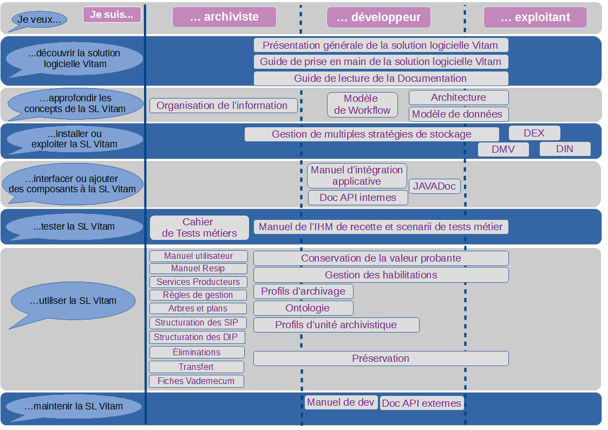

* [**Javadoc**](/https://download.programmevitam.fr/vitam_repository/10.0.0/doc/javadoc/index.html)
* [**Manuel d'intégration applicative** - présentation des principes de d'usage des interfaces](https://download.programmevitam.fr/vitam_repository/10.0.0/doc/html/manuel-integration/index.html) \| [pdf](https://download.programmevitam.fr/vitam_repository/10.0.0/doc/pdf/vitam-manuel-integration.10.0.0.pdf)
* [**Modèle de données** - description des collections et des champs standards](https://www.programmevitam.fr/vitam-doc/fr/master_10.0.x/sections/modele_de_donnees.html))
* [**Documentation d'API externes** - description des API REST externes en Html](https://download.programmevitam.fr/vitam_repository/10.0.0/doc/raml/externe/)
* [**Manuel de développement** - éléments d'architecture interne et de méthode utiles aux développements de la solution logicielle VITAM](https://download.programmevitam.fr/vitam_repository/10.0.0/doc/html/manuel-dev/index.html)
\| [pdf](/https://download.programmevitam.fr/vitam_repository/10.0.0/doc/pdf/vitam-manuel-developpement.10.0.0.pdf)
* [**Documentation d'API internes** - description des API REST internes en Html et Raml](https://download.programmevitam.fr/vitam_repository/10.0.0/doc/raml/interne/)

# Documentation

* [Première approche](https://www.programmevitam.fr/pages/documentation/pour_approche_deb/)
* [Vademecums ou "Vitam pour mes grands-parents"](https://www.programmevitam.fr/vitam-doc/fr/master_10.0.x/sections/Vademecum_sommaire.html)
* [Documentation métier](https://www.programmevitam.fr/pages/documentation/pour_archiviste/)
* [Documentation des tests](https://www.programmevitam.fr/pages/documentation/pour_test/)
* [Documentation technique](https://www.programmevitam.fr/pages/documentation/pour_tech/)
* [Documentation Vitam UI](https://www.programmevitam.fr/pages/documentation/pour_vitamUI/)
* [Documentation ReSIP](https://www.programmevitam.fr/pages/documentation/resip/)
* [Chantier préservation : documentation](https://www.programmevitam.fr/pages/documentation/sur_chantier_preservation/)

