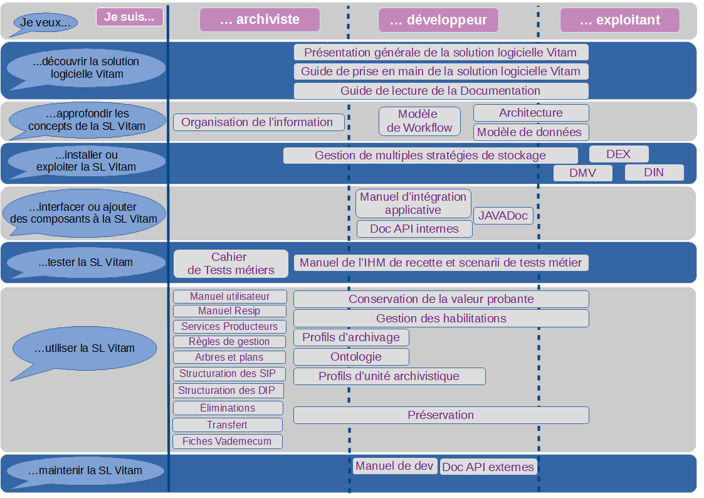

* **Vitam back-office : dossier d'architecture technique** (DAT) ([pdf](https://download.programmevitam.fr/vitam_repository/10.0.0/doc/pdf/vitam-architecture.10.0.0.pdf) \| [html](https://download.programmevitam.fr/vitam_repository/10.0.0/doc/html/archi/index.html))  

* **Vitam back-office : dossier d'installation** (DIN) ([pdf](https://download.programmevitam.fr/vitam_repository/10.0.0/doc/pdf/vitam-documentation-installation.10.0.0.pdf) \| [html](https://download.programmevitam.fr/vitam_repository/10.0.0/doc/html/installation/index.html))

* **Vitam back-office : dossier d'exploitation** (DEX) ([pdf](https://download.programmevitam.fr/vitam_repository/10.0.0/doc/pdf/vitam-documentation-exploitation.10.0.0.pdf) \| [html](https://download.programmevitam.fr/vitam_repository/10.0.0/doc/html/exploitation/index.html))  

* **Vitam UI : dossier d'architecture technique** (DAT) ([html](https://download.programmevitam.fr/vitamui_repository/9.1.0/doc/architecture/))

* **Vitam UI : dossier d'installation** ([html](https://download.programmevitam.fr/vitamui_repository/9.1.0/doc/installation/))

* **Vitam UI : dossier d'exploitation** ([html](https://download.programmevitam.fr/vitamui_repository/9.1.0/doc/exploitation/))

* **Documentation de montées de version back-office** (DMV) ([pdf](https://download.programmevitam.fr/vitam_repository/10.0.0/doc/pdf/vitam-documentation-migration.10.0.0.pdf) \| [html](https://download.programmevitam.fr/vitam_repository/10.0.0/doc/html/migration/index.html))  

* **Documentation de montées de version Vitam UI** (DMV) ([html](https://download.programmevitam.fr/vitamui_repository/9.1.0/doc/migration/))

# Documentation
* [Première approche](https://www.programmevitam.fr/pages/documentation/pour_approche_deb/)
* [Vademecums ou "Vitam pour mes grands-parents"](https://www.programmevitam.fr/vitam-doc/fr/master_10.0.x/sections/Vademecum_sommaire.html)
* [Documentation métier](https://www.programmevitam.fr/pages/documentation/pour_archiviste/)
* [Documentation des tests](https://www.programmevitam.fr/pages/documentation/pour_test/)
* [Documentation développeur](https://www.programmevitam.fr/pages/documentation/pour_dev/)
* [Documentation Vitam UI](https://www.programmevitam.fr/pages/documentation/pour_vitamUI/)
* [Documentation ReSIP](https://www.programmevitam.fr/pages/documentation/resip/)
* [Chantier préservation : documentation](https://www.programmevitam.fr/pages/documentation/sur_chantier_preservation/)

